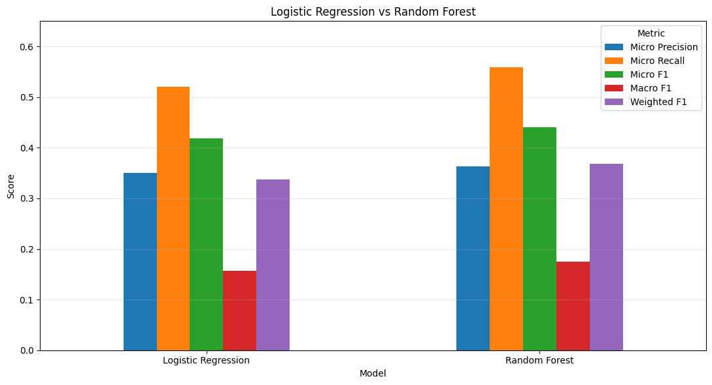
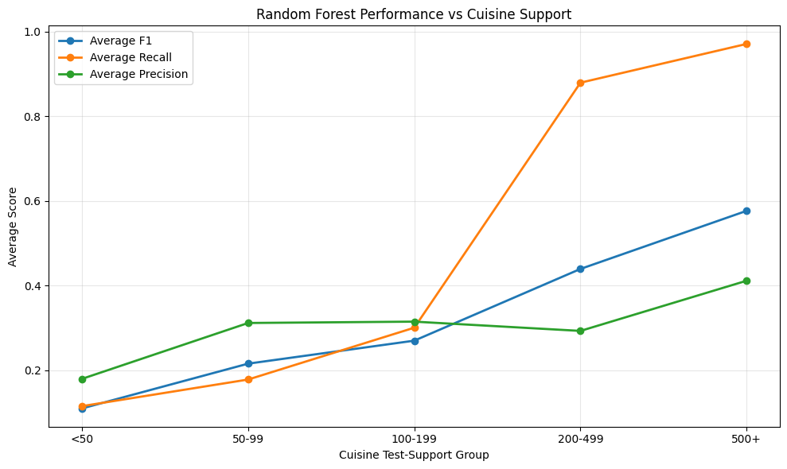
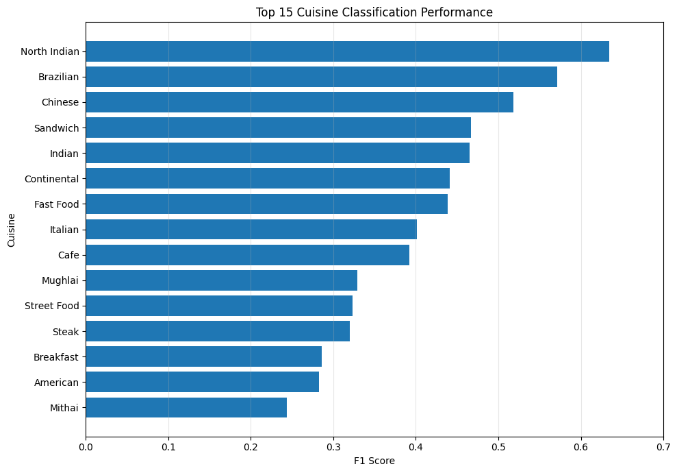

# Cognifyz Task 3 — Restaurant Cuisine Classification

Machine learning project completed for the **Cognifyz Machine Learning Internship — Task 3**.

## Objective

Develop a machine learning model to classify restaurants based on their cuisines. Because a restaurant can have more than one cuisine label, the project treats this as a **multi-label classification** problem.

## Dataset

- 9,551 restaurant records
- 21 original columns
- 9 missing cuisine labels
- 0 duplicate rows
- 145 individual cuisine labels
- 19,710 cuisine assignments
- Average cuisines per restaurant: 2.07
- 64.43% of restaurants have multiple cuisines

The current repository contains `Dataset .csv`, and the notebook expects this filename at `/content/Dataset .csv` in Google Colab. **Before sharing the public repository, confirm that the dataset's source terms permit redistribution.** If not, remove the CSV from the repository and upload it privately to Colab; `.gitignore` alone does not remove a file that has already been committed.

## Methodology

1. Dataset quality audit and exploratory analysis
2. Missing-target handling
3. Multi-label target construction with `MultiLabelBinarizer`
4. Rare-label filtering for the primary experiment
5. Multi-label stratified train/validation/test splitting
6. Numerical transformation and scaling
7. Categorical one-hot encoding
8. Logistic Regression baseline
9. One-vs-Rest Random Forest
10. Validation-based probability threshold selection
11. Frozen test-set evaluation
12. Per-cuisine performance and class-support analysis

## Features

The final primary model uses **11 structured features**:

- Country Code
- City
- Longitude
- Latitude
- Average Cost for two
- Has Table booking
- Has Online delivery
- Is delivering now
- Price range
- Aggregate rating
- Votes

`Currency` was removed because it is largely redundant with `Country Code`.

High-cardinality identifiers/text fields and target-derived fields were excluded to reduce memorization and leakage risk.

## Models

### Logistic Regression

Used as a linear multi-label baseline with One-vs-Rest classification. Probability thresholds were tuned using the validation set.

### Random Forest

A One-vs-Rest Random Forest was evaluated and selected using validation Micro F1. Its probability threshold was also selected from validation data.

## Results

The latest clean run after removing `Currency` produced the following reported metrics:

| Metric | Logistic Regression | Random Forest |
|---|---:|---:|
| Validation Micro F1 | 0.4235 | **0.4398** |
| Test Micro F1 | — | **0.4401** |
| Test Macro F1 | — | **0.1753** |
| Test Weighted F1 | — | **0.3680** |
| Test Hamming Loss | — | **0.0640** |
| Test Exact Match | — | **0.0310** |

The final model was selected using validation performance; the test set was kept for final evaluation.

> **Note:** Micro F1 is not ordinary classification accuracy. Since this is a multi-label problem, Micro F1, Macro F1, Weighted F1, Hamming Loss, and Exact Match are more informative evaluation measures.

## Key Findings

- Cuisine frequencies are highly imbalanced.
- Common cuisines are learned more reliably than rare cuisines.
- The long-tail distribution limits performance on low-support cuisines.
- Per-cuisine evaluation shows substantial variation between frequent and rare labels.
- Support-versus-performance analysis is included in the notebook.

## Limitations

- Rare cuisines have limited training examples.
- One-vs-Rest models treat cuisine labels independently and do not explicitly model label dependencies.
- Exact restaurant names were excluded from the primary model to reduce memorization risk.
- The dataset contains a strong long-tail distribution across cuisine labels.

## Future Work

Potential improvements include:

- Classifier Chain or other label-dependency models
- TF-IDF features from restaurant text fields as a separate experiment
- Transformer-based text representations
- Class-specific probability thresholds
- Resampling or class-aware learning strategies
- Gradient-boosting approaches for additional comparison

## Technologies

- Python
- Pandas
- NumPy
- Scikit-learn
- Matplotlib
- Seaborn
- SciPy
- Google Colab / Jupyter Notebook

## How to Run

### Google Colab

1. Open `Task_3_Cuisine_Classification.ipynb` in Google Colab.
2. Ensure `Dataset .csv` is available in `/content/` (upload it if needed).
3. Run the notebook from the beginning using **Runtime → Run all**. The notebook installs `iterative-stratification` for multi-label stratified splitting.
4. Review validation/test metrics and per-cuisine diagnostics.

### Local Jupyter

1. Install dependencies with `pip install -r requirements.txt`.
2. Place the CSV in the notebook's expected location or update the dataset path.
3. Run the notebook from top to bottom.

## Visual Results

### Model Comparison

The notebook compares precision, recall, and F1 metrics for the evaluated models.

### Performance Across Cuisine Support Groups

This plot highlights how model performance varies with the number of training examples available for each cuisine label.

### Per-Cuisine Performance

The per-cuisine view makes it easier to see differences in performance between individual labels; strong results on common cuisines do not imply equally strong performance on rare cuisines.

## Repository Contents

- `Task_3_Cuisine_Classification.ipynb` — executed notebook with data audit, multi-label modeling, evaluation, and diagnostic visualizations.
- `README.md` — project objective, methodology, reported results, and limitations.
- `requirements.txt` — Python dependencies, including multi-label stratification support.
- `.gitignore` — common generated files and local artifacts to ignore.
- `Dataset .csv` — dataset currently tracked in the repository; confirm redistribution rights before sharing.

## Internship

**Cognifyz Technologies — Machine Learning Internship**  
**Task 3: Cuisine Classification**

